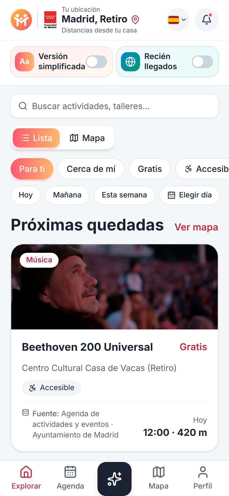
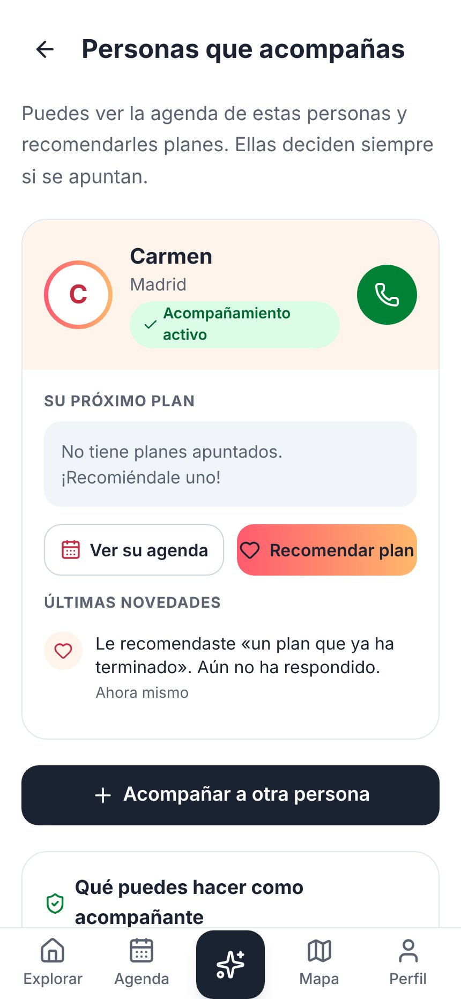
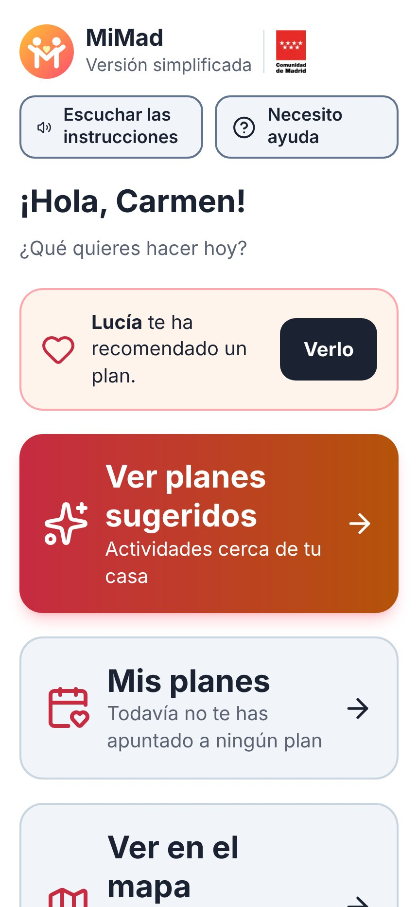
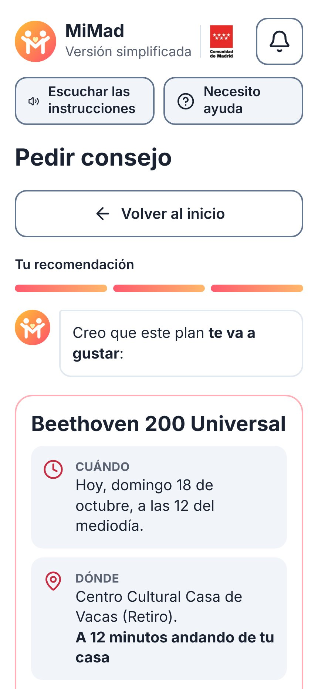
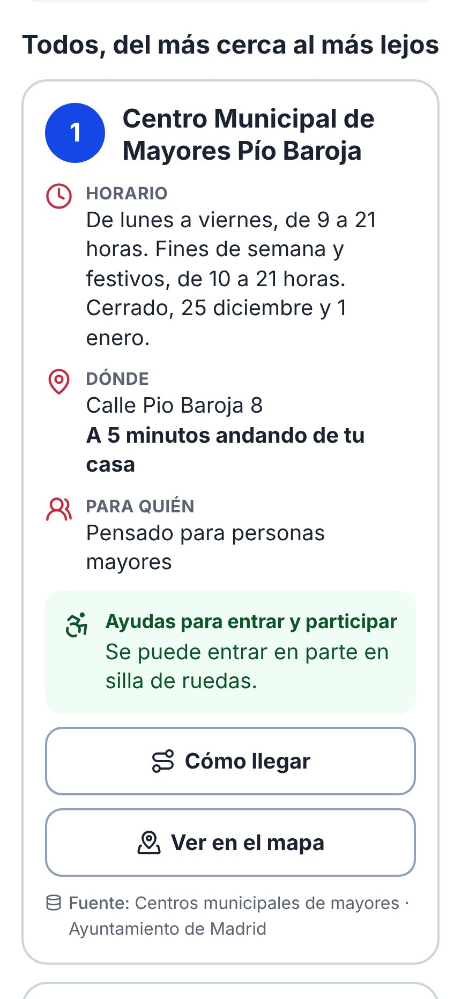

# MiMad

**Madrid, mejor en compañía.** App web (PWA, instalable en el móvil) de planes y actividades para **combatir la soledad y crear comunidad en la Comunidad de Madrid**, construida sobre **datos abiertos**.

Proyecto para el datathon **DataMad 2026**. 🔗 **https://mimad.vercel.app**

Cada plan, sitio y recomendación sale de un dataset público, y cada pantalla dice de cuál («Fuente: …», con enlace a su ficha).

## Para quién

| Perfil | Qué encuentra |
|---|---|
| **Jóvenes y adultos** (versión por defecto) | Planes cerca de casa ordenados por gustos y cercanía, filtros (gratis, accesible, cerca, por día, por intereses), mapa de planes y sitios, agenda, asistente con IA y **Acompañamiento** para vincularse con un familiar mayor y recomendarle planes. |
| **Personas mayores, dependientes o con discapacidad** (versión simplificada) | Botones grandes, un paso por pantalla, textos cortos, lectura en voz alta, «Necesito ayuda» siempre visible, «Pedir consejo» con tres toques y los planes que le recomienda su familia. Se activa con un interruptor y queda guardada en el perfil. |
| **Personas extranjeras** | Interruptor **«Recién llegados»** con las actividades de los CEPI (aprender español, trámites, empleo, convivencia), filtro **«Idiomas»**, la app en 8 idiomas y los planes traducidos. |
| **Entidades y organizaciones** | Cuenta de entidad para publicar planes (con su foto), ver cuántas personas se apuntan y enviarles avisos. Se verifican cruzando su **NIF** con el Registro de centros de atención social. |

## Cómo se ve

| Inicio | Asistente con IA | Acompañamiento | Versión simplificada | Pedir consejo | Mapa sencillo |
|---|---|---|---|---|---|
|  |  |  |  |  |  |

Todas las capturas, en [`docs/capturas/`](docs/capturas/).

## Datos abiertos que usa

| Dataset | Organismo | Para qué | Actualización |
|---|---|---|---|
| [Registro de centros de atención social](https://datos.comunidad.madrid/catalogo/dataset/b8cdb7f7-3185-4938-800a-fefda72333f5) | Comunidad de Madrid | Hogares y clubes de mayores y centros de día en el mapa; verificar el NIF de las entidades | Semanal |
| [Actividades de los CEPI](https://datos.comunidad.madrid/dataset/bc5a430c-1819-4478-87fc-09c771e0455f) | Comunidad de Madrid | «Recién llegados» e «Idiomas» (personas extranjeras) | Semanal |
| [Talleres de envejecimiento activo](https://datos.comunidad.madrid/dataset/a4ae43dd-6f22-4498-b5e8-2ba6308ffa36) | Comunidad de Madrid | Talleres para mayores en toda la región | Mensual |
| [Agenda de actividades y eventos](https://datos.madrid.es/dataset/300107-0-agenda-actividades-eventos) | Ayuntamiento de Madrid | La mayoría de los planes | Diaria |
| [Agenda turística (esmadrid.com)](https://datos.madrid.es/dataset/300028-0-agenda-turismo) | Ayuntamiento de Madrid | Planes con **foto**; también da foto a los planes repetidos de la agenda | Diaria |
| [Centros municipales de mayores](https://datos.madrid.es/dataset/200337-0-centros-mayores) | Ayuntamiento de Madrid | Sitios para mayores en el mapa | Semanal |
| [Juntos contra la soledad](https://sigma.madrid.es/hosted/rest/services/GEOPORTAL/JUNTOS_CONTRA_LA_SOLEDAD/MapServer/0) | Ayuntamiento de Madrid | Talleres semanales contra la soledad | Semanal |

- **CEPI:** el dataset no trae dirección, así que las de los 8 centros se mantienen a mano (`supabase/migrations/20261014000002_cepi_centros.sql`) a partir de la [web de la Comunidad de Madrid](https://www.comunidad.madrid/servicios/servicios-sociales/centros-participacion-e-integracion), con coordenadas de OpenStreetMap. Tampoco trae día ni tipo: en la app se dice «Durante octubre · pregunta en el centro el día y la hora», y el tipo (español, trámites…) se deduce del título.
- **Privacidad:** del registro de atención social solo se muestran hogares y clubes de mayores, centros de día y talleres. Los centros de acogida, de mujeres víctimas de violencia, de menores y los albergues **nunca** se muestran: el filtro está en la base de datos (vistas) y la app no puede leer la tabla completa.
- **Distancias:** la casa de cada persona se sitúa con su código postal o con la ubicación del móvil (redondeada a unos 100 m). El centro de cada código postal se calcula con los propios datos abiertos (`src/data/codigos-postales.json`, se regenera con `npm run codigos-postales`). «Dónde estoy ahora» y «Ver planes en otra zona» solo se guardan en una cookie del móvil durante 3 horas.

## Cómo está hecho

- **Next.js 15** (App Router) + TypeScript + Tailwind CSS, como **PWA**. Publicada en **Vercel** (región Dublín, junto a la base de datos).
- **Supabase** (PostgreSQL + Auth) en Europa (Irlanda).
  - Tablas `da_*`: una por dataset, tal como llega (solo lectura para la app).
  - Vistas `v_eventos` y `v_lugares`: unifican todas las fuentes con las mismas columnas (título, fechas, lugar, coordenadas, gratis, accesibilidad, público, foto…), así la app consulta un solo sitio.
  - Tablas `mm_*`: perfiles, inscripciones, vínculos de acompañamiento, recomendaciones, notificaciones, entidades y sus planes.
  - **Seguridad:** RLS en todas las tablas y permisos explícitos en cada migración. Cada persona solo ve lo suyo; un familiar solo ve a su persona vinculada y solo si el vínculo está aceptado. Lo comprueba `npm run comprobar` con usuarios de prueba reales.
- **Carga de datos:** `scripts/ingest` descarga cada fuente, la normaliza (coordenadas UTM → lat/lon, HTML → texto, fechas…) y la guarda. Lo ejecuta **GitHub Actions** (`.github/workflows/ingest.yml`, horas en UTC): agenda cada día a las 04:00, agenda turística a las 04:30, atención social los domingos, CEPI / centros de mayores / Juntos contra la soledad los lunes y talleres el día 1 de cada mes. Si una fuente falla, se conservan los datos anteriores y el error queda en `da_fuentes`.
- **Mapa:** Leaflet + OpenStreetMap (sin claves).

### Inteligencia artificial (Claude)

Solo en el servidor (la clave nunca llega al navegador) y solo con la sesión iniciada; con límite de uso por persona y hora.

- **Asistente** (`/asistente`) y **«Pedir consejo»** (versión simplificada): se buscan planes **reales** cerca de la persona y Claude elige de esa lista los que mejor encajan y explica por qué. No puede inventar planes: solo puede devolver ids de la lista. Lo que se pide manda sobre los gustos del perfil (si le gusta la música y pide deporte, recomienda deporte). Sin clave o si falla, elige con reglas sencillas.
- **Traducción:** los planes para personas extranjeras (CEPI, idiomas) se traducen solos al idioma elegido; cualquier otro, con el botón «Traducir». Cada traducción se guarda una semana para no repetir el gasto.
- **Modelos:** Claude **Haiku** por defecto (rápido y barato). La variable `ANTHROPIC_MODEL` solo admite Haiku o Sonnet. Los textos fijos de la app se tradujeron una vez con Sonnet y están en el repositorio.

### Idiomas

Junto a la campana se elige idioma: español, inglés, francés, árabe, rumano, chino, ucraniano, portugués o alemán. Los textos fijos de la versión por defecto están en `src/lib/i18n/mensajes.json`, con el texto en español como clave (`t("Gratis")` → «Free»). Al añadir textos nuevos con `t("…")`, `npm run traducir-textos` los encuentra en el código y traduce solo lo nuevo (necesita `ANTHROPIC_API_KEY`).

### Accesibilidad y PWA

- Revisado con [axe-core](https://github.com/dequelabs/axe-core) (WCAG 2.1 AA) en 23 pantallas de las dos versiones, con y sin sesión: **sin fallos**. Contraste AA, etiquetas en botones, navegación completa con teclado y foco visible, y el idioma declarado en cada texto para los lectores de pantalla.
- La versión simplificada tiene letra y botones grandes, alto contraste, una acción principal por pantalla y lectura en voz alta (voz del navegador, sin coste).
- Se instala en el móvil («Añadir a pantalla de inicio»), con accesos directos al mapa, la agenda, el asistente y la versión simplificada. Guarda iconos y fotos en el móvil para ir más rápido; las páginas con datos personales no se guardan. Sin conexión, muestra un aviso con botón para reintentar.

## Ejecutarlo en local

Necesitas **Node.js 20+** y un proyecto gratuito de [Supabase](https://supabase.com) (mejor en una región de Europa).

1. Instala las dependencias: `npm install`
2. En Supabase → **SQL Editor**, ejecuta **en este orden** los archivos de `supabase/migrations/` (cada uno crea sus tablas con sus permisos y reglas de seguridad):

   | Archivo | Qué crea |
   |---|---|
   | `20261014000001_datos_abiertos.sql` | Tablas `da_*` de los datasets y `da_fuentes` |
   | `20261014000002_cepi_centros.sql` | Direcciones de los 8 CEPI |
   | `20261014000003_vistas.sql` | Vistas unificadas `v_eventos` y `v_lugares` (con el filtro de privacidad) |
   | `20261014000004_permisos_carga.sql` | Permisos del script de carga |
   | `20261015000001_tablas_app.sql` | Perfiles, inscripciones, vínculos, recomendaciones, notificaciones |
   | `20261015000002_registro_completo.sql` | Datos del registro (casa, intereses, versión simplificada) |
   | `20261016000001_limites.sql` | Límites de longitud en lo que escribe la gente |
   | `20261016000002_contar_inscritos.sql` | Contador de personas apuntadas |
   | `20261016000003_codigos_vinculo.sql` | Códigos de invitación de Acompañamiento más seguros |
   | `20261016000004_perfil.sql` | Interruptor de avisos y «Borrar mi cuenta» |
   | `20261016000005_fotos_perfil.sql` | Fotos de perfil (Storage) |
   | `20261016000006_notificaciones.sql` | Avisos dentro de la app (los crea la base de datos) |
   | `20261016000007_entidades.sql` | Cuentas de entidad y sus planes |
   | `20261016000008_mensajes_entidad.sql` | Mensajes de la entidad a las personas apuntadas |
   | `20261017000001_fotos_planes.sql` | Fotos de los planes de las entidades y de la agenda turística |
   | `20261018000001_fecha_inscripcion.sql` | Día elegido al apuntarse a un plan de varios días |

3. Copia `.env.example` como `.env.local` y rellena los valores (Supabase → Project Settings → API). La clave de Claude (`ANTHROPIC_API_KEY`, de [console.anthropic.com](https://console.anthropic.com)) es opcional: sin ella, el asistente usa reglas y no hay traducción de planes.
4. Carga los datos abiertos: `npm run ingest` (`npm run ingest -- --prueba` descarga sin guardar).
5. Comprueba datos y permisos: `npm run comprobar` (crea usuarios de prueba, intenta saltarse cada regla de seguridad y los borra al final).
6. Arranca la app: `npm run dev` y abre http://localhost:3000 (mejor en el modo móvil del navegador, a 430 px de ancho).

### Comandos

| Comando | Qué hace |
|---|---|
| `npm run dev` | App en local |
| `npm run build` | Compila (comprueba tipos y lint) |
| `npm run ingest` | Carga todas las fuentes de datos abiertos (o las que se pasen: `npm run ingest -- agenda_madrid`) |
| `npm run comprobar` | Verifica los datos y las reglas de seguridad |
| `npm run traducir-textos` | Traduce los textos fijos nuevos (`-- --lista` solo los enseña) |
| `npm run codigos-postales` | Regenera el centro de cada código postal |

## Publicarlo

- **Vercel:** importa el repositorio y añade las variables `NEXT_PUBLIC_SUPABASE_URL`, `NEXT_PUBLIC_SUPABASE_ANON_KEY` y, si quieres IA, `ANTHROPIC_API_KEY` (y opcionalmente `ANTHROPIC_MODEL`). La clave `SUPABASE_SERVICE_ROLE_KEY` **no** va en Vercel. `vercel.json` fija la región `dub1`: cámbiala si tu Supabase está en otra región. Cada `git push` a `main` se publica solo.
- **GitHub Actions** (carga programada): en Settings → Secrets and variables → Actions, añade `SUPABASE_URL` y `SUPABASE_SERVICE_ROLE_KEY`. También se puede lanzar a mano desde la pestaña Actions.

## Estructura

```
src/app/(app)/      versión por defecto (Inicio, mapa, detalle, agenda, perfil, asistente, entidades…)
src/app/simple/     versión simplificada
src/app/api/        rutas de servidor (asistente, traducción)
src/components/     componentes compartidos
src/lib/            consultas a los datos, IA, traducciones (i18n), formato de fechas…
scripts/ingest/     carga de los datos abiertos
supabase/migrations/ base de datos, permisos y reglas de seguridad
public/             iconos, fotos por tipo de plan, banderas y service worker (sw.js)
```

## Licencia y créditos

Código bajo licencia [MIT](LICENSE).

- **Datos:** pertenecen a sus organismos publicadores (Comunidad de Madrid y Ayuntamiento de Madrid) y se usan según sus condiciones de reutilización.
- **Fotos por defecto** de los planes sin foto propia (`public/fotos-por-tipo/`): [Pexels](https://www.pexels.com), con su [licencia](https://www.pexels.com/license/) de uso libre. Las fotos de la Agenda turística son de [esmadrid.com](https://www.esmadrid.com) y se indican en cada plan.
- **Mapas:** [Leaflet](https://leafletjs.com) y © colaboradores de [OpenStreetMap](https://www.openstreetmap.org/copyright).
- **Banderas:** [flag-icons](https://github.com/lipis/flag-icons) (MIT). **Iconos:** [Lucide](https://lucide.dev) (ISC). **Fuente:** [Outfit](https://fonts.google.com/specimen/Outfit) (OFL).
- **IA:** [Claude](https://www.anthropic.com/claude), de Anthropic.
